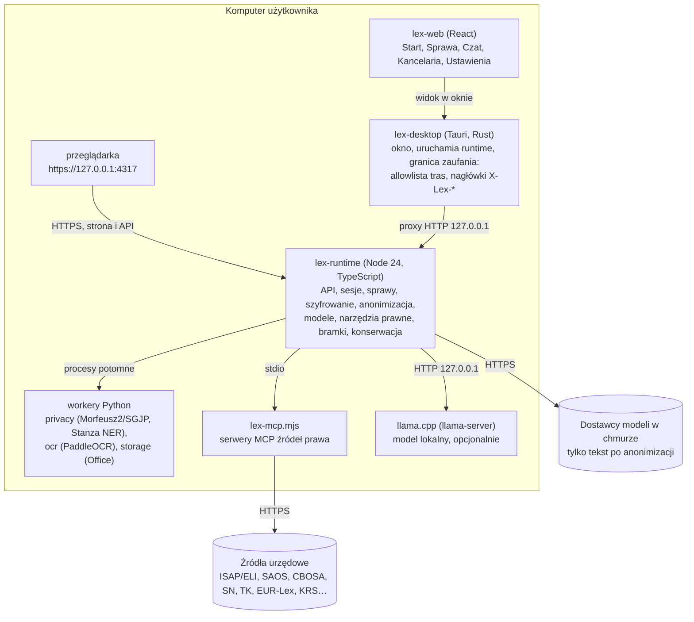

<div align="center">

# Lex Machina

**Lokalna aplikacja desktopowa — asystent prawny AI dla prawa polskiego, działający na komputerze użytkownika, z obowiązkową weryfikacją każdego przepisu u źródła i prywatnością danych sprawy z założenia.**

[](LICENSE)
[](#wersjonowanie)
[](#instalacja)
[](#architektura)
[](#modele-ai)
[](#)

[Czym jest](#czym-jest-lex-machina) •
[Możliwości](#kluczowe-mo%C5%BCliwo%C5%9Bci) •
[Architektura](#architektura) •
[Prywatność](#prywatno%C5%9B%C4%87-i-anonimizacja) •
[Modele](#modele-ai) •
[Źródła prawa](#%C5%BAr%C3%B3d%C5%82a-prawa) •
[Bramki](#bramki-antyhalucynacyjne) •
[Bezpieczeństwo](#bezpiecze%C5%84stwo) •
[Tryb serwerowy](#tryb-serwerowy-i-przegl%C4%85darka) •
[Instalacja](#instalacja) •
[Budowa](#budowa-ze-%C5%BAr%C3%B3de%C5%82)

</div>

---

## Czym jest Lex Machina

Lex Machina to **samodzielna aplikacja desktopowa** (Windows, macOS), która zamienia dowolny wspierany model językowy w warsztat pracy z prawem polskim — bez oddawania akt sprawy do chmury i bez cytowania przepisów „z pamięci" modelu.

Trzy filary odróżniają ją od zwykłego czatu z LLM:

1. **Prywatność z założenia** — dane spraw przetwarzane są lokalnie; do modeli zewnętrznych trafiają wyłącznie symbole zastępcze (`[PII:PERSON:0001|GEN]`), a klucz do nich jest zaszyfrowany na dysku użytkownika.
2. **Weryfikacja u źródła** — każdy artykuł, każda pozycja Dz.U. i każda sygnatura są potwierdzane w urzędowym repozytorium (Sejm ELI) lub przez narzędzia w tej samej turze; przepis bez pokrycia nie wchodzi do odpowiedzi finalnej.
3. **Lokalny runtime jako źródło prawdy** — logika (sprawy, szyfrowanie, anonimizacja, orkiestracja modeli, bramki) działa w procesie na komputerze użytkownika, nie w chmurze. Ten sam interfejs jest dostępny w oknie aplikacji i w przeglądarce pod `https://127.0.0.1:4317`.

> Niniejszy dokument opisuje **aplikację** — runtime, interfejs i mechanizmy. Metodyka prawna (router, dziedziny prawa, skille wykonawcze) jest **osobnym projektem**: żyje we własnym repozytorium [`michaleiatrak-star/Lex-Machina`](https://github.com/michaleiatrak-star/Lex-Machina), ma własną dokumentację i jest udostępniana na **licencji GPL-3.0**. Dla aplikacji skille są opcjonalnym dodatkiem, który wczytuje z katalogu `Wersja rozwojowa rozpakowana/`; aplikacja działa też z innym zestawem skilli lub bez korpusu. Aplikacja i korpus skilli mają różnych właścicieli licencyjnych — zob. [Kontakt i licencja](#kontakt-i-licencja).

---

## Kluczowe możliwości

| Obszar | Co potrafi aplikacja |
|---|---|
| **Zarządzanie sprawami** | Osobny, zaszyfrowany magazyn i klucz per sprawa; foldery, pliki, terminarz, kontakty, pamięć sprawy i streszczenie. |
| **Wczytywanie dokumentów** | PDF, obrazy, DOCX, ODT, XLSX/XLSM, CSV/TSV, TXT/MD oraz ZIP (bezpieczne rozpakowanie z limitami); wbudowany edytor DOCX/ODT i arkuszy. |
| **OCR lokalny** | Polski PP-OCRv6 (Paddle) dla stron bez warstwy tekstowej i grafik; rozliczenie wszystkich stron bez ucięcia; korekta OCR ograniczona słownikiem. |
| **Anonimizacja** | Wielowarstwowe rozpoznawanie PII (słownik SGJP/Morfeusz2, Stanza NER, detektory identyfikatorów, opcjonalnie model lokalny) z odwracalnym, lokalnym kluczem. |
| **Czat prawny** | Załączniki z miernikiem tokenów, obrazy jako dowód z maskowaniem PII, 6-etapowy potok z widocznym postępem, bramka złożoności. |
| **Generowanie pism** | Pisma, opinie, umowy i raporty jako pliki `.docx`/`.odt` do pobrania; status DRAFT do akceptacji; automatyczna deanonimizacja wyników. |
| **Modele AI** | API (Anthropic, OpenAI, xAI, Google), konta CLI (Claude, Codex, Gemini, Grok) oraz modele lokalne (llama.cpp, np. Bielik) — jeden spójny interfejs. |
| **Źródła prawa** | Weryfikacja w Sejm ELI + 16 konektorów MCP (ISAP, EUR-Lex, SAOS, CBOSA, SN, KRS, WL, CEIDG, NBP, EUREKA, SUDOP, UODO, KIO, TK, sądy powszechne, ETPCz) i karta Wyszukiwanie. |
| **Biblioteka kancelarii** | Wspólny, zaszyfrowany magazyn wzorów DOCX/ODT i dokumentów know-how z wyszukiwaniem semantycznym. |
| **Konta i uprawnienia** | Lokalne konta (Argon2id), role per sprawa (OWNER/EDITOR/ANALYST/VIEWER), koperty kluczy per użytkownik, odzyskiwanie hasła, re-autoryzacja operacji wrażliwych. |
| **Faktury** | Wystawianie i druk faktur z danymi sprzedawcy, numeracją i ustawieniami domyślnymi; wysyłka do KSeF niedostępna w tej wersji. |
| **Tryb serwerowy** | Praca wielu osób przez przeglądarkę: rejestracja e-mailem, plany z limitem tokenów, globalne klucze API i limit, podgląd tur, dostęp lokalny albo z sieci (HTTPS). |

---

## Architektura



| Warstwa | Katalog | Technologia | Rola |
|---|---|---|---|
| Desktop | `app/lex-desktop` | Tauri, Rust | Okno, uruchomienie runtime, granica zaufania (CORS, nagłówki, allowlista tras) |
| Runtime | `app/lex-runtime` | TypeScript, Node ≥ 24.7 | API HTTP, strona aplikacji (HTTPS), sprawy, szyfrowanie, anonimizacja, modele, narzędzia, bramki |
| Interfejs | `app/lex-web` | React | Czat, zakładka Sprawa, Kancelaria, Ustawienia |
| Workery | `app/privacy`, `app/ocr`, `app/storage` | Python | NER i słowniki, OCR, odczyt/zapis Office |
| Konektory | `…/audyt-systemu-v4/mcp-servers` | Node (MCP) | Federacja źródeł prawa |
| Instalator | `app/installer`, `.github/workflows/` | NSIS, PowerShell | Instalator online Windows i macOS |

Runtime jest źródłem prawdy; `app/lex-runtime/dist` jest budowany i wersjonowany w repozytorium (instalator kopiuje `dist` i zbudowaną stronę `lex-web` do `app/web`). Komunikacja desktop → runtime przechodzi wyłącznie dozwolone trasy (`DESKTOP_ROUTE_NOT_ALLOWED` przy odstępstwie) — API liczy ok. 240 tras HTTP.

---

## Prywatność i anonimizacja

**Zasada nadrzędna:** dane sprawy nie opuszczają komputera w postaci jawnej, chyba że użytkownik świadomie wyśle tekst jawny. Model zewnętrzny widzi symbole, nie dane.

- **Rozpoznawanie PII (suma wyników, odporne na błąd pojedynczego detektora):**
  1. słownik SGJP (Morfeusz2) — imiona, nazwiska we wszystkich formach, adresy;
  2. Stanza NER (polski model, offline);
  3. detektory identyfikatorów: PESEL, NIP, REGON, IBAN, KRS, dowód, paszport, telefon, e-mail, księga wieczysta, nr rejestracyjny, karta;
  4. opcjonalnie lokalny model AI, który ocenia wątpliwe trafienia w kontekście całego zdania.
- **Reguły instytucji i ról:** rzeczownik instytucji (`Bank Pekao S.A.`, `Rada Gminy`) nie jest osobą; rola strony (`Najemca Kowalski`) wskazuje, że następne słowo to osoba.
- **Osoby, rodziny, firmy:** obsługa stron wieloosobowych (`państwo Wiśniewscy`), wspólnego nazwiska (`Piotrowi i Marii Nowakom`) i firm z nazwiskiem (`PHU Jan Kowalski`), z osobnymi symbolami i rodzajem/liczbą w kluczu dla modelu.
- **Odmiana (HARD GATE):** model musi dopisać przypadek do symbolu (`|NOM|GEN|DAT|ACC|INS|LOC|VOC`); wartość odmienia lokalnie Lex. Brak przypadku lub niepewna forma → oznaczenie do przeglądu.
- **Klucz wspólny sprawy:** jedna osoba = jeden symbol we wszystkich plikach sprawy i w czacie; odwracalny, szyfrowany lokalnie, z rotacją klucza.
- **Przegląd użytkownika:** podgląd z zaznaczonymi słowami; można dodać tekst do anonimizacji, poprawić formy przypadków lub usunąć symbol przed wysyłką.

Audyt (`app/privacy/benchmarks`, 500 dokumentów): skuteczność 100%, 0 wycieków, 0 fałszywych trafień, deanonimizacja 100%.

---

## Dokumenty: OCR i wczytywanie

- **Cztery tryby przetwarzania** (wybór przy każdym pliku, nic nie startuje samo): `OCR + anonimizacja`, `OCR + anonimizacja z AI`, `Tylko OCR`, `Tylko OCR z korektą AI`.
- OCR uruchamia się tylko dla stron bez warstwy tekstowej lub z grafiką; tekst cyfrowy idzie od razu dalej. Pasek postępu z numerem strony: odczyt → OCR → wykrywanie → [lokalne AI] → anonimizacja → zapis klucza.
- **Korekta OCR** działa na całych fragmentach, ale zmiany są drobne i ograniczone słownikiem (ogonki, sklejenie/rozcięcie słów, usunięcie symboli bez znaczenia); liczby, daty, kwoty, identyfikatory i `§` zostają nienaruszone, stylu autora się nie zmienia.
- **ZIP:** rozpakowanie lokalne z ochroną przed traversal/symlink/bombą; członkowie nigdy nie trafiają do modelu automatycznie.

---

## Modele AI

| Rodzaj | Jak działa |
|---|---|
| **API** (Anthropic, OpenAI, xAI, Google) | Klucz w pamięci procesu lub keyringu systemu; dwie najnowsze wersje każdej rodziny. Pętla narzędzi w jednym strumieniu; stały prompt systemowy między turami (cache promptu i historii u dostawcy). |
| **Konto Claude (CLI)** | Jeden proces `claude -p` w trybie `--restricted` (tylko `Read/Glob/Grep`, bez powłoki, internetu i zapisu); narzędzia Lex przez serwer MCP. |
| **Konto Codex / Gemini / Grok (CLI)** | Jeden proces CLI na turę z narzędziami Lex przez serwer MCP; narzędzia hosta (powłoka, pliki, wyszukiwarka) wyłączone. Grok: profil agenta tylko z narzędziami `lex__*`. Wyłączniki: `LEX_CODEX_MCP=0`, `LEX_GEMINI_MCP=0`, `LEX_GROK_MCP=0`. |
| **Lokalny** (llama.cpp, np. Bielik) | Kompaktowy routing, RAG z rdzenia aktów w prompcie, limit 4 plików; używany też do korekty OCR i wspomagania anonimizacji. |

- **Bramka złożoności** (bez wywołania modelu): `TRIVIAL` / `SIMPLE` / `STANDARD` — steruje kosztem i wybiera szybką ścieżkę dla prostych pytań.
- **Szybka odpowiedź (model lokalny):** prompt ~3× mniejszy (ok. 8–11 tys. znaków zamiast ~25 tys.), rdzeń aktów z ELI, maks. 3 rundy.
- **Strażnik źródeł:** każdy artykuł, pozycja Dz.U., URL i powołane narzędzie muszą pochodzić z tekstów ELI lub wyników narzędzi danej tury; inaczej jedna runda korekty, potem blokada.

---

## Źródła prawa

- **Weryfikacja przepisów:** każdy akt (także KC/KPC/KK/KPK) jest potwierdzany w Sejm ELI z kontrolą aktualności (bieżący tekst jednolity, nowelizacje po nim, vacatio legis per artykuł). Gdy ELI potwierdzi, że lokalna kopia tekstu jednolitego jest aktualna, brzmienie pochodzi z tej kopii (RAG) — znacznik `✅ [VER: …, ŹRÓDŁO: RAG (kopia t.j. z ELI)]`; bez potwierdzenia — pełna weryfikacja w ELI. Wyłącznik: `LEX_CLOUD_LOCAL_COPY=0`.
- **16 konektorów MCP** (federacja w czacie, karta Wyszukiwanie): ISAP/ELI, EUR-Lex, SAOS, CBOSA (NSA/WSA), Sąd Najwyższy, KRS, Biała lista VAT, CEIDG (wymaga własnego klucza API), NBP, EUREKA (interpretacje podatkowe), SUDOP, UODO, KIO, Trybunał Konstytucyjny, sądy powszechne (orzeczenia.ms.gov.pl), ETPCz.
- **Karta Wyszukiwanie:** wynik wprost z API źródła, bez modelu — materiał do odnalezienia źródła, nie weryfikacja. NSA/WSA to snapshot; brak trafień = `OUT_OF_SCOPE`.

---

## Bramki antyhalucynacyjne

Aplikacja egzekwuje serię bramek walidacyjnych (G0–G40) przed każdym wynikiem finalnym lub eksportem:

- **G8 — HARD GATE:** niepopart przepis lub orzeczenie nie może po cichu stać się odpowiedzią finalną.
- **Finalizacja:** niezweryfikowany przepis/Dz.U. pokazywany wyłącznie z `⚠️ [NIEWERYFIKOWANE]` przy samym odwołaniu; zmyślona lub zmieniona sygnatura, cytat albo teza blokuje odpowiedź.
- **G10 — Export Gate:** nieprawidłowe cytaty/weryfikacja blokują eksport; `.docx` tylko po walidacji HYBRID-VAL.
- **G9 — Audit:** każda odpowiedź finalna ma kompletny, audytowalny ślad wykonania.
- **Routing:** `prawny-router-v3` zawsze pierwszy; sprawa karna wymaga kwalifikatora karnomaterialnego (brak = runda korekty, dalej brak = blokada).

---

## Bezpieczeństwo

- Okno aplikacji łączy się z runtime na losowym porcie `127.0.0.1` z tokenem okna; desktop przepuszcza tylko nagłówki `X-Lex-*` z listy i tylko trasy z allowlisty.
- Strona w przeglądarce: domyślnie tylko `127.0.0.1` i HTTPS; dostęp z sieci tylko w trybie serwerowym — zob. [Tryb serwerowy i przeglądarka](#tryb-serwerowy-i-przegl%C4%85darka).
- Magazyny spraw i klucze anonimizacji szyfrowane kluczem sprawy; rotacja przy odebraniu dostępu.
- Konta lokalne: Argon2id (koperta UMK z hasła), trwałe metadane logowania, backoff po błędach, wygasanie sesji; role ACL per sprawa i oddzielne uprawnienie `canReidentify`.
- Koperty kluczy: niezależny 256-bitowy klucz per sprawa (CDK), koperty UMK/X25519 per użytkownik, ścieżka rotacji przy odbieraniu dostępu.
- Modele kont CLI nie mają powłoki, internetu, zapisu ani serwerów MCP konta; dostają tylko narzędzia Lex.
- Most narzędzi MCP: prywatny kanał (named pipe / socket 0600) z jednorazowym tokenem na turę.

---

## Tryb serwerowy i przeglądarka

Po uruchomieniu aplikacja jest dostępna w przeglądarce pod **`https://127.0.0.1:4317`** (ten sam interfejs co okno; `http://` przechodzi na `https://`). Ustawienia → **Tryb serwerowy** (tylko administrator, tylko w przeglądarce):

| Ustawienie | Opcje |
|---|---|
| Tryb serwerowy | Konta rejestrowane e-mailem (SMTP), plany z miesięcznym limitem tokenów i listą dostawców, globalne klucze API i globalny limit, podgląd tur. Funkcje komputera (konta CLI, aktualizacje, folder Pobrane) wyłączone. |
| Dostęp przez przeglądarkę | **Lokalny (domyślny)** — tylko `127.0.0.1`. **Z sieci** — `https://<IP serwera>:4317`; wymaga trybu serwerowego, HTTPS i zmienionego hasła `admin`; zmiana tylko z komputera serwera. |
| Protokół | **HTTPS (domyślny)** albo HTTP (tylko dostęp lokalny lub za serwerem pośredniczącym z HTTPS). |

- **Certyfikat:** aplikacja wystawia własny (localhost, `127.0.0.1`, nazwa i adresy komputera); przeglądarka ostrzega, dopóki nie dodasz go do zaufanych (link „Pobierz certyfikat” w panelu, `/lex-certificate.crt`). Własny certyfikat kancelarii: `custom.crt` i `custom.key` w katalogu danych `server/tls` albo `LEX_TLS_CERT`/`LEX_TLS_KEY`.
- **Zabezpieczenia dostępu z sieci:** tylko adresy IP serwera i nazwy z `LEX_ALLOWED_HOSTS` (ochrona przed DNS rebinding), żądania tylko z tej samej strony, bez funkcji komputera serwera i funkcji okna desktop, limit prób logowania.
- **Role:** administrator nie podlega planom (tylko limitowi globalnemu); konto użytkownika nie widzi trybu dewelopera ani zakładek administracyjnych, a serwer odrzuca operacje administracyjne.

---

## Instalacja

**Wymagania:** Windows 10/11 (x64) lub macOS (Apple silicon). Instalator online pobiera prywatny Node i Python przy pierwszym uruchomieniu (sumy SHA-256 z `app/installer/windows-release-source.json`).

1. Pobierz instalator z [najnowszego wydania](https://github.com/michaleiatrak-star/Lex-machina-aplikacja/releases/latest): `Lex-Machina-<wersja>-Online-x64-Setup.exe` (Windows) albo `Lex-Machina-<wersja>-macOS-arm64-Online.pkg` (macOS); sumy w `SHA256SUMS.txt`.
2. Instalatory są niepodpisane — Windows: przy SmartScreen „Więcej informacji" → „Uruchom mimo to"; macOS: Ustawienia systemowe → Prywatność i ochrona → „Otwórz mimo to".
3. Windows: instalacja w profilu użytkownika, bez uprawnień administratora.
4. Pierwsze logowanie: `admin` / `admin` — aplikacja wymusza zmianę hasła (min. 10 znaków).

Nowszą wersję instaluje się nowszym instalatorem (dane i ustawienia zostają); instalacja aktualizacji z aplikacji jest wyłączona do czasu podpisu Authenticode. Skille można odświeżać w aplikacji (Ustawienia → Aplikacja i utrzymanie, administrator).

**Skille w Claude Code (marketplace):** dodawaj marketplace przypięty do tagu wydania, nie do `main` — wtyczki ze ścieżek względnych pochodzą z tej samej rewizji:

```
/plugin marketplace add michaleiatrak-star/Lex-machina-aplikacja#v0.1.46
```

Konektory MCP skilli działają z pakietu w repozytorium (`audyt-systemu-v4/mcp-servers/dist/lex-mcp.mjs`, suma w `CHECKSUMS.sha256`), bez pobierania z npm. Przykładowy `claude_desktop_config.json` z serwerem zewnętrznym przypina wersję (`@matematicsolutions/mcp-isap@1.3.0`).

---

## Budowa ze źródeł

```bash
# runtime
cd app/lex-runtime && npm install && npm run typecheck && npx vitest run && npm run build
# interfejs
cd app/lex-web && npm install && npx tsc -b && npx vitest run && npm run build && npm run validate:g14
# walidatory bramek (przykłady)
cd app/lex-runtime && npm run validate:g8 && npm run validate:g33d && npm run validate:g36
# trasy runtime a allowlista proxy desktopu
python3 app/lex-desktop/scripts/check-route-allowlist.py
# lista słów instytucji i ról (po zmianie)
python app/privacy/generate_generic_words.py
```

Instalator buduje i sprawdza workflow `lex-installer.yml` (pull request, `workflow_dispatch`); wydanie (Windows online i macOS, tag `v<wersja>`) publikuje `publish-windows-installers.yml` po zmianie wersji na `main`. Nie wymaga sekretów (instalatory niepodpisane). Pełna dokumentacja: [użytkowa](docs/APLIKACJA-DOKUMENTACJA.md) · [techniczna](docs/DOKUMENTACJA-TECHNICZNA.md).

### Wybrane zmienne środowiskowe

| Zmienna | Znaczenie |
|---|---|
| `LEX_HOST`, `LEX_PORT` | Adres runtime (tylko loopback; bez aplikacji desktop domyślnie port 4317). |
| `LEX_BROWSER_PORT` | Port strony w przeglądarce przy aplikacji desktop (domyślnie 4317, `0` wyłącza). |
| `LEX_ALLOWED_HOSTS`, `LEX_TLS_CERT`, `LEX_TLS_KEY` | Nazwy hostów dla dostępu z sieci; własny certyfikat HTTPS. |
| `LEX_SERVER_MODE_FORCE`, `LEX_SERVER_SECRET_KEY`, `LEX_PUBLIC_BASE_URL`, `LEX_TRUST_PROXY` | Tryb serwerowy ustalony z zewnątrz, klucz szyfrowania sekretów, adres w wiadomościach, adres klienta zza serwera pośredniczącego. |
| `LEX_CLOUD_LOCAL_COPY=0` | Modele w chmurze zawsze weryfikują w ELI zamiast z potwierdzonej kopii lokalnej. |
| `LEX_LOCAL_LLM_ENDPOINT` | Zewnętrzny serwer modelu lokalnego (np. na serwerze). |
| `LEX_CLAUDE_NATIVE_CORPUS=off` | Claude wraca do tekstowego protokołu narzędzi. |
| `LEX_SKILLS_PATH`, `LEX_ACCOUNT_SKILL_DIRS` | Przypięty korpus / katalogi skilli z kont. |
| `LEX_CORE_LAW_DIR`, `LEX_CORE_LAW_REFRESH=off` | Lokalna kopia ELI i jej odświeżanie w tle. |
| `LEX_MCP_PACKAGE`, `LEX_MCP_STATE_DIR`, `CEIDG_API_KEY` | Pakiet serwerów MCP, stan konektorów, klucz CEIDG. |
| `LEX_NER_PYTHON`, `LEX_OCR_PYTHON`, `LEX_GENERIC_WORDS` | Ścieżki workerów i list słów. |

---

## Wersjonowanie

Wersja aplikacji: **0.1.46** (runtime, interfejs i desktop współdzielą numer).

Korpus skilli (osobny projekt GPL-3.0 w repozytorium [`michaleiatrak-star/Lex-Machina`](https://github.com/michaleiatrak-star/Lex-Machina)) jest tu dołączony jako dodatek i ma własne wersjonowanie w dwóch kanałach — `Wersja stabilna rozpakowana <data>/` (codzienna praca) i `Wersja rozwojowa rozpakowana/` (nowe mechanizmy). Aplikację można zaktualizować niezależnie od skilli i odwrotnie.

---

## Znane ograniczenia

- Przyspieszenie trybu natywnego Claude i weryfikacja przez lokalne AI nie były mierzone na prawdziwym koncie/modelu (pokryte testami).
- Strażnik źródeł porównuje numery artykułów, nie akty (finalizacja ELI nadal sprawdza akt).
- Okna kontekstu modeli w hoście przyjęte ostrożnie (Claude 200 tys., OpenAI/Grok 128 tys. tokenów).
- Jakości OCR/korekty na prawdziwych skanach i modelu lokalnym nie mierzono (testy na atrapie silnika).
- Instalator offline nie jest publikowany (`RELEASE_OFFLINE_INSTALLER`); instalatory Windows i macOS są niepodpisane.
- Certyfikat HTTPS aplikacji jest wystawiony przez nią samą — przeglądarka ostrzega do czasu dodania go do zaufanych albo użycia certyfikatu kancelarii.
- Integracja z kontem Google (Gmail, Dysk) jest w kodzie, ale ukryta w interfejsie.

---

## Zastrzeżenia prawne

> **Lex Machina dostarcza informację prawną, nie poradę prawną.**
>
> - Narzędzie wspomagające — **nie zastępuje adwokata ani radcy prawnego**; w sprawach o istotnej wadze skonsultuj się z pełnomocnikiem.
> - Mimo wielowarstwowych bramek każdy przepis i każdą sygnaturę **zweryfikuj samodzielnie** w źródłach oficjalnych (isap.sejm.gov.pl, sn.pl, orzeczenia.ms.gov.pl) przed użyciem w postępowaniu.
> - Wygenerowane pisma mają status **DRAFT** do świadomej akceptacji przez człowieka.
> - Stan prawny zmienia się stale — mapy aktów są „zdjęciem" na datę ostatniego audytu.

---

## Kontakt i licencja

Błędy i sugestie → [Issues](https://github.com/michaleiatrak-star/Lex-machina-aplikacja/issues).

Dwie różne licencje — nie myl ich:

- **Aplikacja** (`app/`, runtime, interfejs, desktop, instalatory) — **kod zastrzeżony**, © 2026 michaleiatrak-star. Wszelkie prawa zastrzeżone. Bezpłatna instalacja i używanie **wyłącznie do osobistego użytku** ([LICENSE](LICENSE)); bez pisemnej zgody autora zabronione jest kopiowanie kodu, modyfikowanie, tworzenie utworów zależnych, rozpowszechnianie i wykorzystanie zawodowe.
- **Korpus skilli** (metodyka prawna, osobne repozytorium [`michaleiatrak-star/Lex-Machina`](https://github.com/michaleiatrak-star/Lex-Machina), tu dołączony jako dodatek) — **GPL-3.0**, z własną dokumentacją i warunkami tej licencji.

Komponenty osób trzecich pozostają na swoich licencjach. Przetwarzanie danych: [Polityka prywatności](POLITYKA-PRYWATNOSCI.md).

<div align="center">
<sub>Lex Machina — prawo z maszyny, weryfikacja ze źródła.</sub>
</div>
